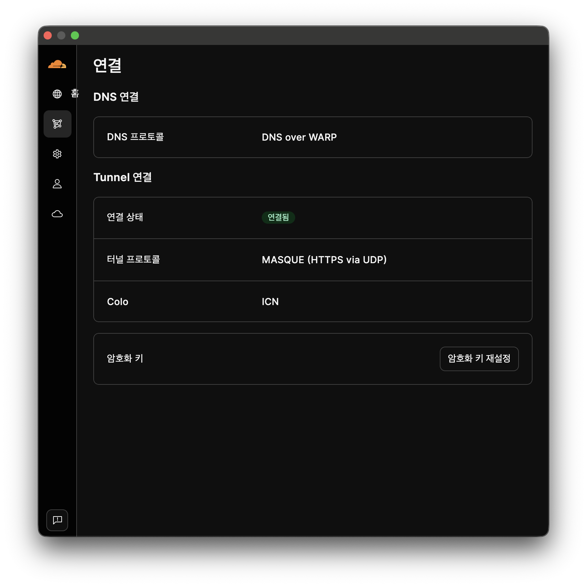
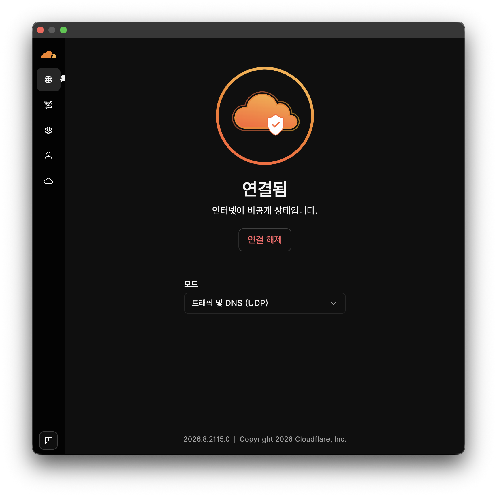
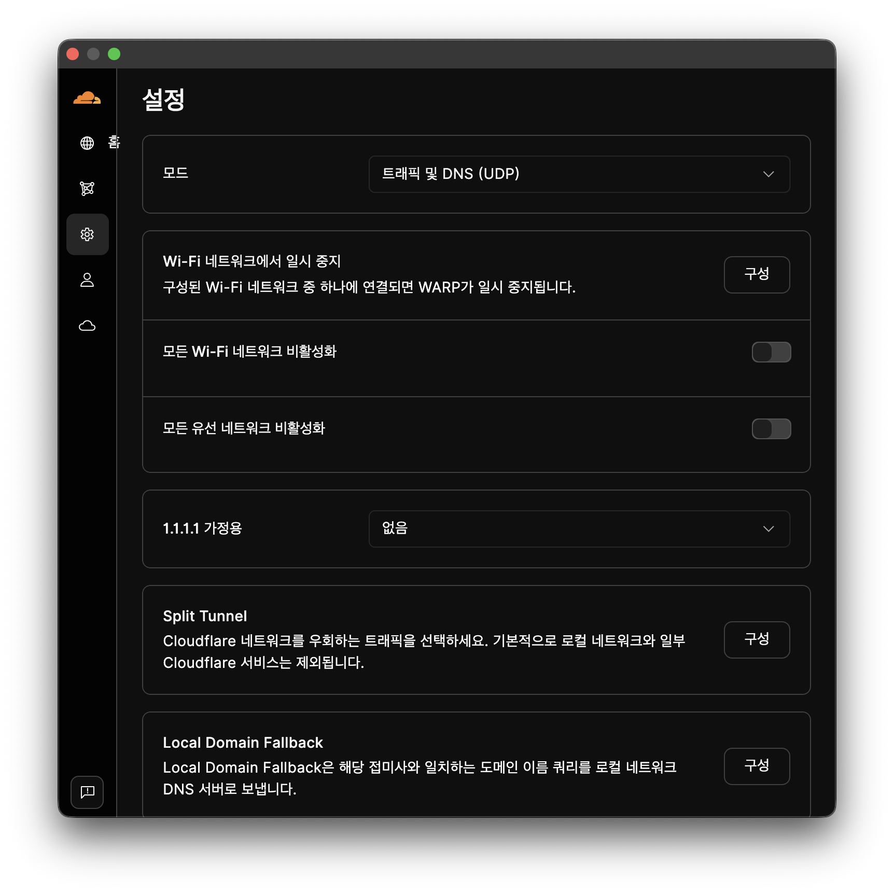
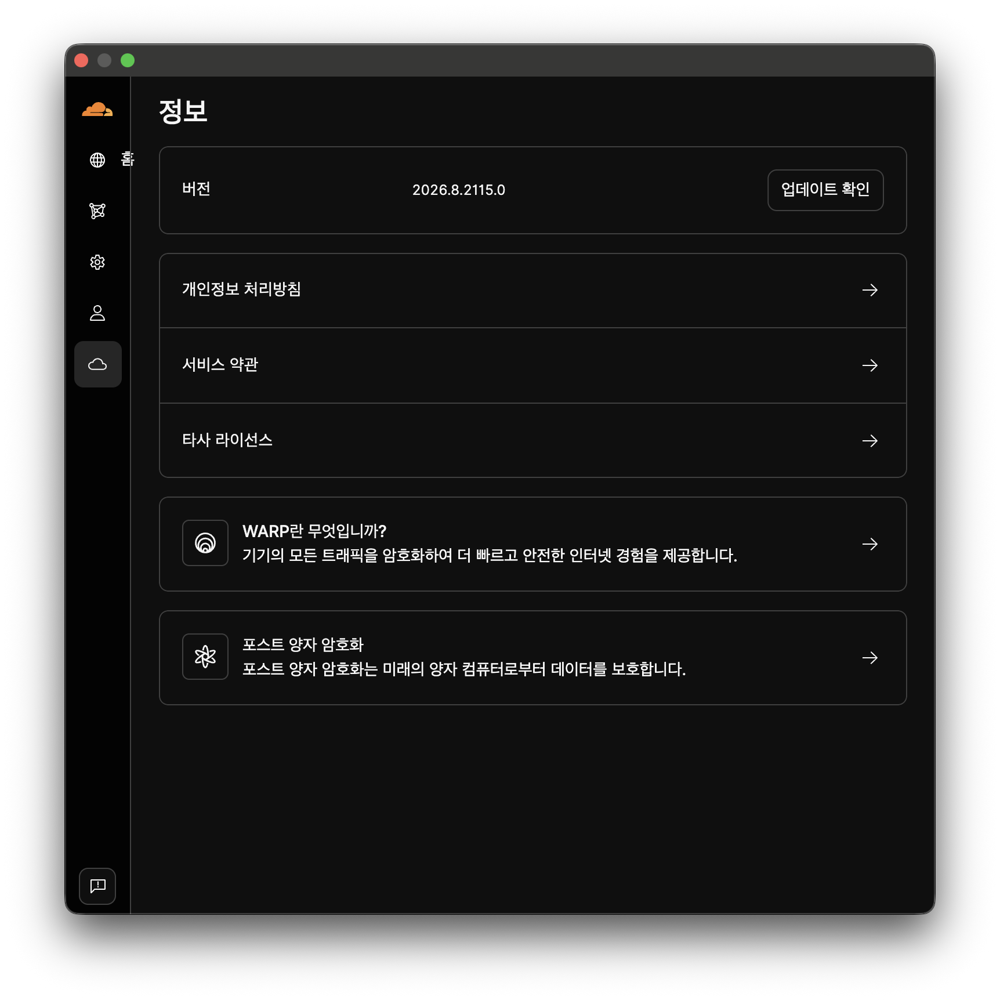

# Cloudflare WARP Korean UI Issues

A collection of UI bugs and visual issues found while using Cloudflare WARP on macOS with the Korean language enabled.

This repository is intended to document these issues clearly, along with screenshots and steps to reproduce them, to help improve the Korean user experience.

---

## Home Label Remains Visible After Collapsing the Sidebar

### Description

I noticed a small UI issue in the left sidebar of Cloudflare WARP.

When the sidebar menu is collapsed, the Korean label **"홈" (Home)** remains visible outside the sidebar, overlapping the main content area.

Interestingly, this issue seems to affect only the Home menu item. I tested the other menu items as well, and the Home label continued to appear even when a different menu was selected before collapsing the sidebar.

### Steps to Reproduce

1. Launch Cloudflare WARP on macOS.
2. Open the WARP application with the sidebar menu expanded.
3. Select a menu item and collapse the sidebar using the **"Collapse Menu"** option.
4. Observe the left sidebar.
5. Repeat the process with other menu items, such as Connect, Info, and Settings.

### Actual Behavior

- The **"홈" (Home)** label remains visible after the sidebar is collapsed.
- The label extends beyond the sidebar boundary into the main content area.
- This happens even when a different menu item is selected before collapsing the sidebar.

### Expected Behavior

- All navigation labels should be hidden when the sidebar is collapsed.
- Only the navigation icons should remain visible.
- No text should extend beyond the sidebar boundary.

### Screenshots

The screenshots below show the sidebar after collapsing it with different menu items selected.

| Connect | Home |
|:---:|:---:|
|  |  |
| Settings | Info |
|  |  |

**Observation:** Regardless of which menu item is selected, the "홈" (Home) label remains visible outside the collapsed sidebar.

### Environment

- **Application:** Cloudflare WARP
- **Platform:** macOS Tahoe 26.6.2
- **UI Language:** Korean
- **Version:** 2026.8.2115.0

---

## Purpose

This repository is a place to document UI issues encountered while using the Korean version of Cloudflare WARP.

Hopefully, these reports will help identify and resolve small UI inconsistencies and make the application experience better for Korean-speaking users.

